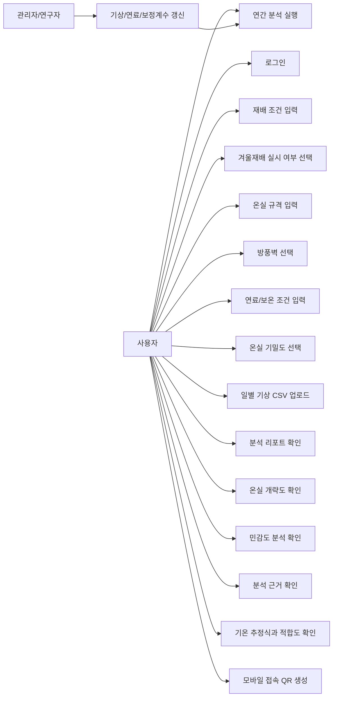
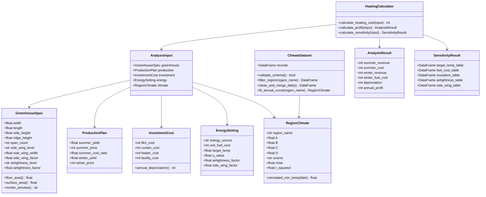
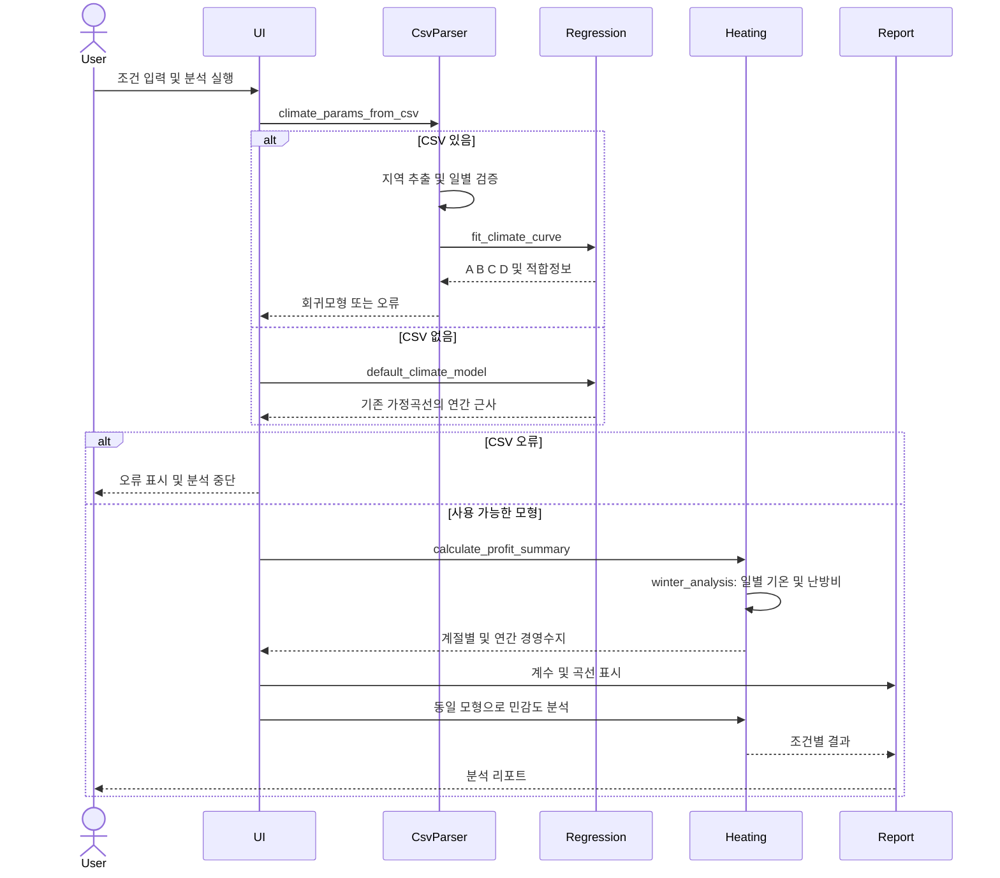
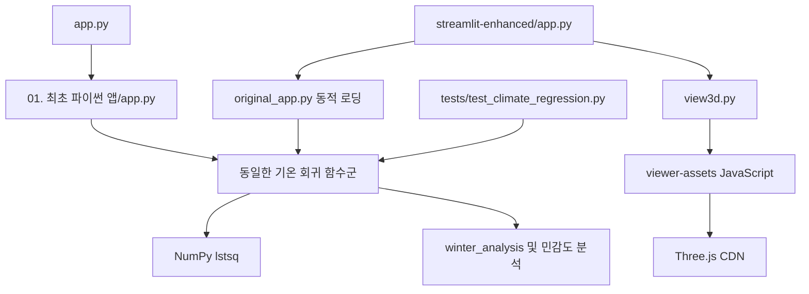
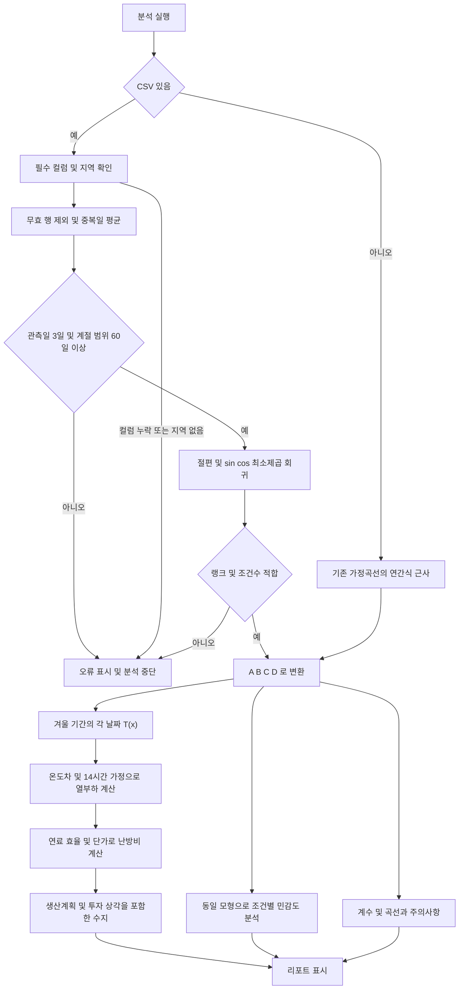

# 무화과 가온재배 의사결정지원 앱 설계도

개정일: 2026-10-20. 연간 사인 회귀모형 수정 브랜치 기준이며 운영 반영은 PR #2 병합·배포 후 확인한다.
이번 기온모형 관련 문서·UML 개정은 사용자 요청에 따라 생성형 AI를 활용해 작성했다. 과거 설계 원본의 작성 시점을 증명하는 자료가 아니다.

## 1. 앱 목표

전남 무화과 가온재배 농가가 겨울 작기 도입 여부를 판단할 수 있도록 난방비, 시설비, 매출, 순이익을 예측한다.

핵심 질문은 다음과 같다.

- 겨울 가온재배를 추가하면 연간 순이익이 증가하는가?
- 지역, 온실 규격, 보온 수준, 연료 단가가 난방비에 얼마나 영향을 주는가?
- 농가별 온실 기밀도 차이가 난방비와 순이익에 얼마나 영향을 주는가?
- 방풍벽 유무와 폭이 외부 바람 노출과 난방부하에 얼마나 영향을 주는가?
- 입력한 온실 규격이 개략적인 온실 형태로 이해 가능하게 표시되는가?
- 투자비를 감가상각까지 반영했을 때 겨울 작기가 경제성이 있는가?
- 목표온도, 연료단가, 보온등급 변화에 따라 결과가 얼마나 민감하게 달라지는가?
- 여러 해의 연중 일별 기상 CSV 자료를 반영하면 지역별 난방비 추정이 어떻게 달라지는가?

## 2. 현재 앱 구성

원본판은 루트 `app.py`가 `01. 최초 파이썬 앱/app.py`를 실행한다. 3D판은 `streamlit-enhanced/app.py`가 `original_app.py`의 함수들을 동적으로 불러온다. 두 계산 본문은 같은 회귀 로직을 유지한다. `src/` 분리는 아직 계획이다.

- 로그인: `APP_PASSWORD` 기반 접근 제한
- 입력: 지역, 온실 규격, 방풍벽, 여름 생산계획, 겨울재배 실시 여부, 겨울 생산계획, 시설투자비, 에너지 조건, 온실 기밀도
- 선택 입력: 여러 해의 연중 일별 기상 CSV 자료
- 계산: 외피면적, 감가상각비, 겨울 난방비, 여름/겨울/연간 순이익, 민감도 분석
- 출력: 여름 재배 성적표, 겨울 재배 투자 성적표, 연간 경영 분석 지표, 온실 개략도, 매출/비용 차트, 민감도 분석, 분석 근거

### 2.1 추가 반영 기능

`기본 입력값`
- 기본 분석 지역은 해남군으로 둔다.
- 기본 온실 규격은 3연동으로 둔다.
- 1동 기준 폭은 8m, 길이는 42m, 측고는 2.5m, 동고(최고높이)는 4.0m로 둔다.
- 온실면적은 `1동 기준 폭 × 길이 × 연동 수`로 계산한다.

`온실 기밀도 선택`
- 농가별 온실 상태 차이를 반영하기 위해 기밀도 선택값을 둔다.
- 기밀도는 난방부하에 곱해지는 보정계수로 사용한다.
- 현재 기본 계수는 다음과 같다.
  - 매우 우수: 0.90
  - 양호: 1.00
  - 보통: 1.10
  - 취약: 1.25
  - 매우 취약: 1.40
- 기밀도는 난방비와 순이익에는 영향을 주지만, 생산량과 판매단가에는 직접 반영하지 않는다.
- 향후 실제 농가 난방비 기록이 확보되면 기밀도 계수를 실측자료 기반으로 보정한다.

`재배 방식 선택`
- 재배 방식은 `여름재배(관행)`과 `겨울재배` 중 하나를 선택하게 한다.
- 기본 선택값은 `겨울재배`로 둔다.
- `여름재배(관행)` 선택 시 여름 작기만 분석한다.
- 연간 생산계획의 수량과 판매단가 입력값은 천 단위 쉼표를 표시한다.
- 겨울재배 선택 시 300평 기준 기본 생산계획은 여름 1,219kg, 겨울 635kg으로 둔다.
- 겨울재배 생산량 기본값은 `300평 기준 생산량 × (현재 온실면적 평수 ÷ 300평)`으로 환산한다.
- 겨울재배 실시 시 기본 판매단가는 여름 6,400원/kg, 겨울 30,000원/kg으로 둔다.
- 겨울재배 선택 시 기본 여름철 경영비 비율은 43%로 둔다.
- 여름재배(관행) 선택 시 300평 기준 기본 생산계획은 여름 2,500kg으로 둔다.
- 여름재배(관행) 생산량 기본값은 `300평 기준 생산량 × (현재 온실면적 평수 ÷ 300평)`으로 환산한다.
- 여름재배(관행) 선택 시 기본 판매단가는 6,400원/kg으로 둔다.
- 여름재배(관행) 선택 시 기본 여름철 경영비 비율은 40%로 둔다.
- 여름재배(관행) 선택 시 겨울 매출, 난방비, 겨울 투자 상각은 0으로 계산한다.
- 여름재배(관행) 선택 시 난방비 중심 민감도 분석은 표시하지 않는다.
- 결과 화면에는 여름 재배 성적표를 항상 표시하고, 겨울재배 선택 시 겨울 재배 투자 성적표를 추가로 표시한다.
- 겨울 재배 투자 성적표에는 겨울 비용을 난방비와 시설 감가상각비로 분해한 보조 설명을 표시한다.

`면적비례 투자비 및 감가상각`
- 감가상각에 사용하는 기본 투자비는 첨부 엑셀의 300평 기준 자료를 따른다.
- 기준 시트는 `연장재배 투자비(300평)`과 `경영비(10a, 300평)`이다.
- 300평 기준 기본 투자비는 이중비닐 공사 957만원, 보온커튼 공사 840만원, 이중비닐 피복재 24만원, 다겹보온커튼 자재비 248만원으로 둔다.
- 현재 온실 투자비 기본값은 `300평 기준 투자비 × (현재 온실면적 평수 ÷ 300평)`으로 환산한다.
- 감가상각 연수는 이중비닐 공사 10년, 보온커튼 공사 10년, 이중비닐 피복재 3년, 다겹보온커튼 자재비 5년으로 둔다.
- 기본 보온등급은 감가상각 투자비에 다겹보온커튼이 포함된 조건과 일치하도록 `다겹보온커튼 (U=2.0)`으로 둔다.
- 사용자는 자동 환산된 투자비 기본값을 현장 견적에 맞게 수정할 수 있다.

`온실 개략도 표시`
- 사용자가 입력한 온실 폭, 길이, 측고, 동고(최고높이), 연동 수, 방풍벽을 바탕으로 결과 화면에 온실 개략도를 표시한다.
- 별도의 단동/연동 선택 항목은 두지 않고, 연동 수가 1이면 단동, 2 이상이면 연동으로 자동 해석한다.
- 목적은 사용자가 입력값이 실제 온실 형태와 맞는지 직관적으로 확인하게 하는 것이다.
- 무화과 가온재배 온실은 일반적으로 아치형 지붕 비닐하우스 형태가 많으므로, 각 단동 아치가 연동 수만큼 이어진 구조로 표시한다.
- 방풍벽이 있는 경우 온실 양쪽 사이드에서 바닥으로 곡선형으로 내려가는 방풍벽으로 표시해 농가 현실과 입력값을 함께 확인할 수 있게 한다.
- 개략도에는 온실 길이, 측고, 동고(최고높이), 피복/보온 조건을 명확한 라벨로 함께 표시한다.
- 온실 폭은 1동 기준 입력값과 전체 온실 폭을 구분해 표시한다. 전체 온실 폭은 `1동 폭 × 연동 수`로 계산한다.
- 면적 지표는 농가가 이해하기 쉬운 `온실면적` 명칭으로 표시한다.
- 동고(최고높이)는 실제 온실 높이감이 드러나도록 측고 대비 아치 높이 비율을 충분히 크게 표현한다.
- 피복/보온 조건은 현재 선택한 보온 등급과 보온커튼 투자 여부를 요약해 표시한다.
- 모바일 브라우저에서 SVG 일부 요소가 누락되지 않도록, 개략도는 인라인 SVG 직접삽입이 아니라 SVG를 이미지 데이터로 인코딩해 표시한다.
- 장기적으로는 개략도 옆에 외피면적 산출 근거를 함께 표시해 계산 신뢰도를 높인다.

`방풍벽 보정`
- 방풍벽은 기밀도와 별도로 외부 바람 노출을 낮추는 환경 보정값으로 둔다.
- 현장에서는 날개부처럼 표현될 수 있으나, 앱과 설계도에서는 정식 항목명을 `방풍벽`으로 통일한다.
- 보통 온실 폭 기준 양쪽 사이드에 약 1.5m 방풍벽이 있는 경우를 표준으로 둔다.
- 현재 기본 계수는 다음과 같다.
  - 없음: 1.00
  - 한쪽 방풍벽: 0.97
  - 양쪽 방풍벽 표준: 0.94
  - 양쪽 방풍벽+보강: 0.90
- 방풍벽 계수는 난방부하에 곱해지는 보정계수로 사용한다.
- 향후 현장 조사 자료가 확보되면 방풍벽 폭, 길이, 재질, 방향을 세분화한다.

## 3. 재편 시 권장 폴더 구조

```text
fig-heating-decision-app/
  app.py
  requirements.txt
  README.md
  data/
    region_climate_params.csv
    climate_10y_hourly.csv
    fuel_settings.csv
  src/
    auth.py
    constants.py
    models.py
    calculations.py
    charts.py
    ui.py
  tests/
    test_calculations.py
```

## 3.1 현재 Streamlit Cloud 배포 구조

GitHub와 Streamlit Community Cloud에 바로 연결하기 위해 현재 저장소 루트에는 배포용 진입 파일을 둔다.

```text
의사결정모델 구현/
  app.py                         # Streamlit Cloud용 진입 파일
  requirements.txt               # 배포용 의존성
  README.md                      # GitHub/Streamlit 배포 안내
  .gitignore
  .streamlit/
    config.toml
    secrets.toml.example
  01. 최초 파이썬 앱/
    app.py                       # 실제 앱 본문
    APP_BLUEPRINT.md             # 설계도 및 UML
    climate_csv_template.csv
    requirements.txt             # 로컬 실행용 의존성
    run_app.ps1
    run_app.bat
  streamlit-enhanced/
    app.py                       # 3D판 진입점 v0.5
    original_app.py              # 원본판과 같은 계산 함수 본문
    view3d.py
    viewer-assets/
    requirements.txt
  docs/CLIMATE_MODEL.md          # 회귀·CSV·검증 명세
  tests/test_climate_regression.py
```

- Streamlit Cloud의 Main file path는 루트 `app.py`로 지정한다.
- 루트 `app.py`는 기존 앱 본문인 `01. 최초 파이썬 앱/app.py`를 실행한다.
- 실제 비밀번호는 GitHub에 올리지 않고, Streamlit Cloud의 Secrets에 `APP_PASSWORD`로 등록한다.
- `.streamlit/secrets.toml.example`은 배포자가 참고하는 예시 파일이며 실제 비밀값은 포함하지 않는다.

## 4. 모듈별 역할

아래 `src/`, `data/` 항목은 모듈 분리를 위한 향후 역할안이며 실제 파일이 아니다. 현재 구현 함수는 [기온모형 명세](../docs/CLIMATE_MODEL.md)의 대응표를 따른다.

`app.py`
- Streamlit 실행 진입점
- 페이지 설정, 로그인 호출, 입력/계산/출력 흐름 연결

`src/auth.py`
- 비밀번호 읽기
- 로그인 화면과 세션 상태 관리

`src/constants.py`
- 지역 목록
- U값
- 연료별 발열량, 효율, 기본 단가
- 기본 연료는 농사용 전기로 둔다.
- 농사용 전기는 저압 기준으로 전력량요금 65.9원/kWh, 기본요금 1,150원/kW·월을 기본값으로 둔다.
- 등유/면세유 계열 기본 단가는 기존 값을 유지한다.
- 사용자가 연료를 바꾸면 연료 단가 입력값도 해당 연료의 기본값으로 자동 갱신한다.
- 겨울 작기 기간

`src/models.py`
- 입력값 묶음용 데이터 구조
- 계산 결과 묶음용 데이터 구조

`src/calculations.py`
- 외피면적 계산
- 기밀도 보정계수 반영
- 방풍벽 보정계수 반영
- 감가상각 계산
- 농사용 전기 선택 시 겨울 기간 최대 시간당 전력수요(kW)를 추정하고, 전력량요금 외에 기본요금 1,150원/kW·월을 겨울 개월 수만큼 추가한다.
- 기본 보온등급 `다겹보온커튼 (U=2.0)`의 U값을 난방부하 계산에 직접 반영하며, 별도 현실보정계수는 적용하지 않는다.
- 외기온 시뮬레이션 또는 CSV 기반 기상자료 분석
- 난방비 계산
- 여름/겨울/연간 손익 계산
- 민감도 분석

`src/ui.py`
- 사이드바 입력 폼
- 결과 카드
- 온실 개략도
- 민감도 분석 탭
- 분석 근거 영역

`src/charts.py`
- 매출 차트
- 비용 차트
- 민감도 분석 차트

`src/greenhouse_view.py`
- 입력 규격 기반 온실 개략도 생성
- 각 단동 아치가 연결된 연동 지붕, 1동 폭, 전체 온실 폭, 길이, 측고, 동고(최고높이), 연동 수, 곡선형 방풍벽, 피복/보온 조건을 시각적으로 표시
- Streamlit 화면에는 인코딩된 SVG 이미지로 렌더링해 데스크톱과 모바일 표시 차이를 줄인다.

`data/climate_10y_hourly.csv`
- 10년치 지역별 기상자료 원본 또는 전처리 자료
- 최소 컬럼: `region`, `date`, `min_temp`
- 고도화 시 권장 컬럼: `region`, `datetime`, `temp`, `min_temp`, `max_temp`, `source_station`

## 5. 알고리즘 고도화 방향

1. 현재 수정 브랜치에서 구현한 내용
- 연간 고정 주기 `T(x) = A + B sin(Cx + D)`; `C = 2π / 365.2425`.
- 선택 지역 전체 일별 CSV 자료의 절편·사인·코사인 최소제곱 회귀로 A·B·D 추정.
- 관측일의 평균을 보존하는 절편 포함 회귀. 월평균의 평균에서 사인을 다시 빼던 CSV 계수 산출 폐기.
- CSV가 없으면 기존 가정곡선을 연간식으로 근사하되 관측 회귀 결과로 표시하지 않음.
- 계수·학습자료 RMSE·R²·곡선·제한된 자료 경고 표시. 잘못된 CSV는 분석 중단.
- 난방비·민감도 분석에 동일한 곡선 적용. 가온 14시간 및 외피면적·기밀도·방풍벽 보정은 기존 가정 유지.

2. 후속 개선 계획
- 여러 해의 관측자료로 지역 기본곡선을 재보정하고 독립 연도 검증
- 시간별 외기온·설정온도 자료로 14시간 일최저기온 대체 가정 개선
- 평년·한파·온난 시나리오 분리

3. 3단계
- 실제 농가 난방비 기록으로 보정계수 추정
- 연료별 단가 변동 시나리오
- 목표온도별 수량/품질 변화 반영

4. 4단계
- 추천 알고리즘 추가
- 예: 목표 순이익을 만족하는 최소 보온 수준, 적정 목표온도, 손익분기 단가 제안

## 6. UML 설계

UML과 처리 흐름은 앱 수정·확장 시 기준 역할을 한다. 클래스·시퀀스는 UML이며, 유스케이스 요약·컴포넌트 관계·데이터 흐름은 Mermaid 흐름도로 나타낸다. 아래 다이어그램은 Mermaid 문법으로 작성되어 GitHub Markdown에서 바로 확인하거나 수정할 수 있다.

### 6.1 유스케이스 다이어그램

사용자 관점에서 앱이 제공해야 하는 기능을 정리한다.



### 6.2 클래스 다이어그램

향후 `src/models.py`와 `src/calculations.py`로 분리할 때 사용할 데이터 구조와 계산 객체의 관계를 나타낸다.



### 6.3 시퀀스 다이어그램 (현재 구현)

현재 함수 호출 순서에 대응한다. 참여 요소는 실제 구현된 함수군을 나타낸다.



### 6.4 컴포넌트 관계 (현재 구현)

현재 파일과 함수군의 연결을 나타낸다. `src/` 구조와 6.2절의 클래스는 아직 구현되지 않았다.



### 6.5 기상 데이터와 계산 흐름

CSV 미지정 시 대체 경로와 잘못된 CSV의 분석 중단을 명시한다. 아래는 처리 흐름도로 정식 UML 활동 다이어그램 표기는 아니다.



## 7. 다음 구현 우선순위

1. `app.py`를 `src/` 모듈 구조로 분리
2. 기존 기온 회귀 단위검사를 유지하며 시간별 열부하 검증 확장
3. 지역 기상 파라미터를 CSV로 분리
4. 난방 모델을 `간이 14시간`과 `시간별 24시간` 두 방식으로 선택 가능하게 확장
5. 기밀도 계수를 실제 농가 실측 난방비로 보정
6. 방풍벽 계수를 현장 조건에 맞게 보정
7. 온실 개략도를 실제 사진/도면 기준의 연동 아치 구조로 더 정교화
8. 현재 CSV 일별 규칙을 유지하고 관측소·출처 메타데이터 확장
9. 독립 연도 검증과 시간별 외기온 모형 추가
10. 민감도 분석을 손익분기점 추천 기능으로 확장
11. 배포용 README 작성 및 GitHub/Streamlit Cloud 배포 설정 유지

## 8. 검증 기준

- 같은 입력이면 항상 같은 결과가 나와야 한다.
- 생산량, 단가, 투자비, 연료 단가가 0이어도 앱이 멈추지 않아야 한다.
- `st.set_page_config()`는 앱에서 한 번만 호출되어야 한다.
- 계산 로직은 Streamlit UI 없이도 테스트 가능해야 한다.
- 기상자료 출처와 가정값은 화면에 명확히 표시되어야 한다.
- CSV 업로드 시 필수 컬럼 누락, 날짜 오류, 선택 지역 미존재 상황을 안내해야 한다.
- 민감도 분석은 기준 입력값을 바꾸지 않고 별도 시나리오로 계산해야 한다.
- 겨울재배 미실시 선택 시 여름 재배 성적표와 여름 기준 연간 소득만 계산되어야 한다.
- 겨울재배 미실시 선택 시 겨울 난방비, 겨울 매출, 겨울 투자 상각은 0이어야 한다.
- 겨울재배 미실시 선택 시 난방비 중심 민감도 분석은 표시하지 않는다.
- 기밀도 계수는 난방부하 계산에만 반영하고 매출 계산에는 직접 반영하지 않는다.
- 방풍벽 계수는 난방부하 계산에만 반영하고 매출 계산에는 직접 반영하지 않는다.
- 온실 개략도는 각 단동 아치가 연결된 연동 구조를 기본으로 하며, 사용자가 입력한 1동 폭, 계산된 전체 온실 폭, 길이, 측고, 동고(최고높이), 연동 수, 곡선형 방풍벽, 피복/보온 조건을 표시해야 한다.


### 8.1 기온모형 검증 완료 범위

- `python -m unittest discover -s tests -v`: 회귀계수 복원, 관측일 평균 보존, CSV 재읽기, 무효·중복행 처리, 오류, 상수·윤년, 난방비 연결, 두 계산 본문 동기화 등 8개 검사.
- Streamlit AppTest: 원본판·3D판 기본 분석, 3D판 CSV 회귀·재실행·오류 시 중단 확인.
- RMSE·R²는 학습자료 적합도이며 독립 예측 검증이 아니다. 실측 난방비 정확도·3D 브라우저 렌더링은 이번 검증 범위가 아니다.
- 기존 겨울 매출 계절가중치, 겨울 기타 경영비 미포함, U값 단위 확인 등은 별도 개선사항이다.
