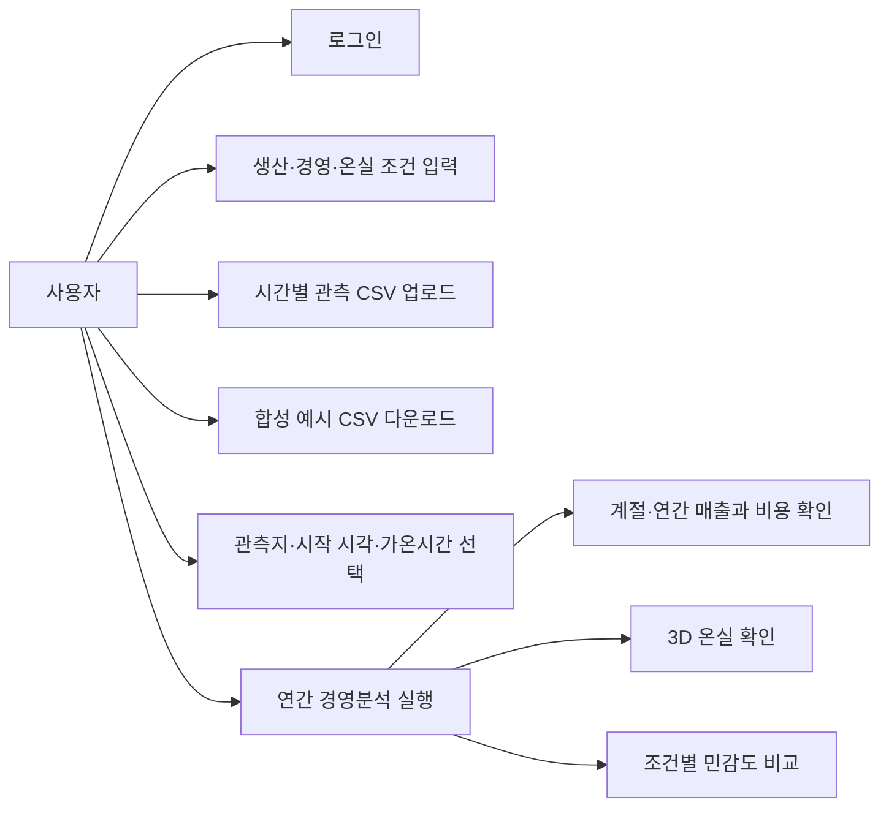
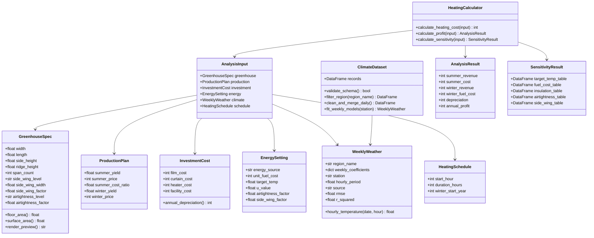
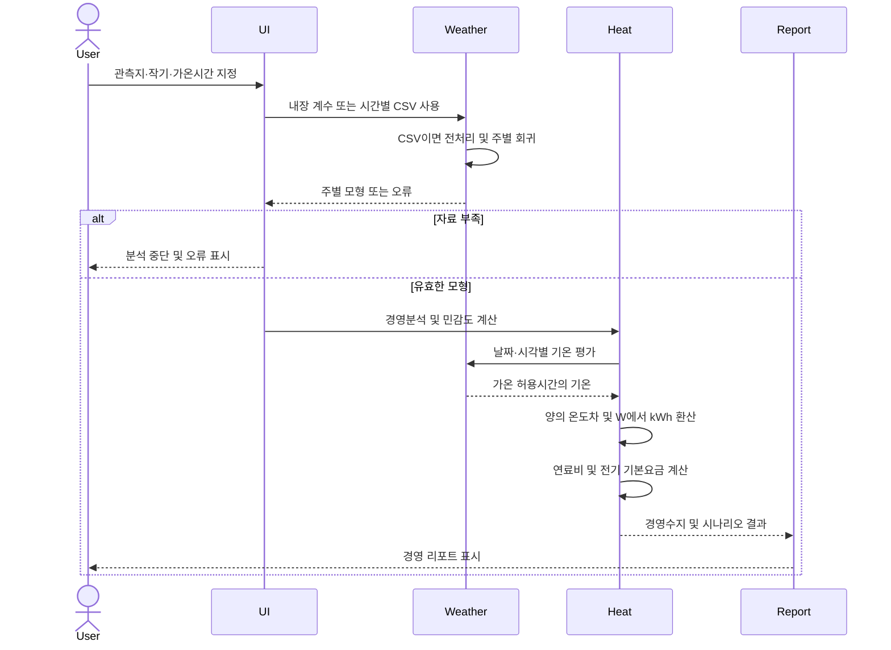
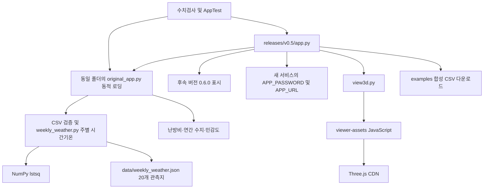
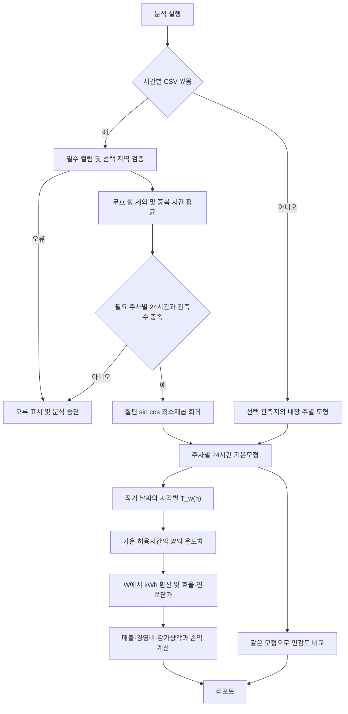

# 무화과 시설재배 경영의사결정지원시스템 — 후속 버전 설계

버전: 0.6.0 / 개정일: 2026-10-21.
`releases/v0.5`의 독립 앱만 설명한다. 등록 신청 당시 제출본이나 기존 운영 앱을 대체한 문서가 아니다.
이번 구현·문서·UML 갱신에는 생성형 AI를 활용했다.

## 1. 버전 경계

- 기존 원본판 `app.py` 및 `01. 최초 파이썬 앱/app.py`는 main 기준 코드를 유지한다.
- 기존 3D판 `streamlit-enhanced/`도 main 기준 코드를 유지한다.
- 새 앱은 `releases/v0.5/app.py`에서 실행한다. 독립 `original_app.py`, `view3d.py`, JavaScript, 패키지 목록과 예시 CSV를 포함한다.
- 현재 main 기반 기존 파일을 바꾸지 않은 상태로 새 앱을 별도 Streamlit 서비스에 배포할 수 있다.
- 비밀번호와 QR 주소는 새 서비스의 APP_PASSWORD·APP_URL로 설정한다. 기본 비밀번호는 1234이다.

## 2. 현재 구현과 계산

생산량·판매단가로 매출, 여름 경영비 비율, 겨울 난방비와 시설 감가상각, 계절별·연간 손익을 계산한다. 보온·목표온도·연료단가·기밀도·방풍벽 조건의 민감도를 비교한다. 3D 식재·설비는 예시이며 생산량·투자비 계산과 독립이다.

2016~2025년 시간별 관측자료로 관측지·주차별 24시간 대표곡선을 적합한다. 같은 주는 같은 함수를 적용하고 다음 주에 계수를 변경한다. 사용자가 정한 가온 허용시간에 시간별 양의 온도차만 합산하며, U의 W 단위를 kWh로 환산한다. 계수·기온곡선은 내부 계산용이다. 자료가 없거나 부족하면 분석을 중단하며 다른 지역 자료로 대체하지 않는다.

자세한 계수·데이터·검증 명세: [CLIMATE_MODEL.md](CLIMATE_MODEL.md).

## 3. 파일 구조

```text
releases/v0.5/
  app.py                 # 후속 버전 화면·접속·마지막 결과 유지
  original_app.py        # 독립 계산 함수 본문 (기존 파일을 런타임에 참조하지 않음)
  view3d.py
  viewer-assets/         # 온실·식재·설비 JavaScript
  requirements.txt
  weekly_weather.py      # 주차별 시간기온·열부하
  data/weekly_weather.json # 20개 관측지별 52주 계수 (원자료 미포함)
  VERSION                # 0.6.0
  run_app.bat
  .streamlit/secrets.toml.example
  examples/hourly_climate_example.csv  # 합성 예시, 관측자료 아님
  tests/test_weekly_weather.py
  tests/smoke_app.py
  docs/                  # 설계·명세·다이어그램 원본
```

## 4. 사용자 기능 요약

아래는 유스케이스 요약 흐름도이다.



## 5. 클래스 UML — 향후 구조 분리안

현재 실제 코드는 함수와 dict 기반이다. 아래 클래스는 객체·모듈로 분리할 때의 설계안이며 구현 완료를 뜻하지 않는다.



## 6. 시퀀스 UML — 후속 버전의 실제 호출



## 7. 후속 버전 컴포넌트 관계

현재 파일·함수군 연결을 표현한 흐름도이다. 기존 앱은 별도 서비스로 유지한다.



## 8. 데이터 처리 흐름



## 9. 검증·운영 경계

- 수치·CSV·난방비 연결 단위검사 21개 및 AppTest 로그인·분석·CSV 회귀·재실행·오류 중단 확인.
- 다이어그램 5종은 Mermaid 문법과 SVG·PNG 렌더링 확인.
- 원본판과 기존 3D판 실행 소스는 main과 동일한지 별도 비교.
- 예시 CSV는 합성자료이며 실측 검증을 대신하지 않는다.
- 2025년 기온은 이전 연도로 적합한 곡선으로 별도 검증했다. 시간대 대표평균의 적합 RMSE와 독립연도 기온 RMSE는 구분한다.
- 실측 난방비 검증, 일별 목표온도 변경, 시간별 관측 자체를 이용한 연도별 난방비 분석은 후속 과제이다.
